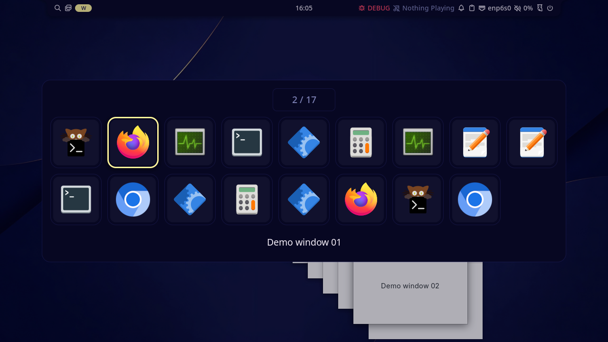

import IpcCommand from '../../../../components/IpcCommand.astro';

These commands control shell state, logging, settings windows, the window switcher, and session actions.

## General

| Action               | Command                                                      | Description                                                                                                                                            |
| -------------------- | ------------------------------------------------------------ | ------------------------------------------------------------------------------------------------------------------------------------------------------ |
| Print status         | <IpcCommand command="status" />                              | Print basic shell state as JSON.                                                                                                                       |
| Show log level       | <IpcCommand command="log-level-status" />                    | Print the current console log level.                                                                                                                   |
| Set log level        | <IpcCommand command="log-level-set debug" />                 | Set the console log level for the running session. Use `debug`, `info`, `warn`, or `error`.                                                            |
| Reload config        | <IpcCommand command="config-reload" />                       | Reload the merged Noctalia config stack immediately.                                                                                                   |
| Get config           | <IpcCommand command="config-get <path>" />                   | Print the effective value at a config path, including built-in defaults (e.g. `config-get shell.font_family`). Unknown paths return an error.          |
| Set config           | <IpcCommand command="config-set <path> <value>" />           | Validate a TOML value and save it at a config path in `settings.toml`, then reload. Quote strings (e.g. `config-set shell.font_family "'Noto Sans'"`). |
| Open settings        | <IpcCommand command="settings-open [context]" />             | Open or focus the graphical settings window, optionally at a specific section (e.g. `bar`).                                                            |
| Open plugin settings | <IpcCommand command="settings-open-plugin noctalia/notes" /> | Open the settings window at an installed plugin's settings. The plugin must be enabled and expose settings.                                            |
| Close settings       | <IpcCommand command="settings-close" />                      | Close the graphical settings window.                                                                                                                   |
| Toggle settings      | <IpcCommand command="settings-toggle [context]" />           | Open or close the graphical settings window, optionally at a specific section.                                                                         |

Set `NOCTALIA_LOG_LEVEL` to `debug`, `info`, `warn`, or `error` before startup to choose the initial console log level. The default is `info`; the file log remains unfiltered.

## Window Switcher

Alt+Tab-style overlay with three presentations selected by `[shell.window_switcher].style`: the default `carousel` uses freestanding selected/near/far cards, while `compact` uses a boxed strip of equal-sized cards. `icons` uses a stationary grid containing all window icons, without capturing previews or imposing the five-card limit. It wraps to additional rows and scales to fit the output. In the icons style, `show_caption` shows only the selected window title below the grid, and icons are always displayed. Carousel cards keep stable proportions and fit snapshots inside a small themed frame, so differing window aspect ratios do not distort the layout. Captions sit below previews and the position counter sits above them. Application icons scale with the rendered preview and follow the carousel direction: bottom-left on left and selected cards, bottom-right on right cards. Close controls follow the same side at the top of left and right cards, while the selected card keeps its close control at the top-right. Moving through the preview styles animates position, scale, opacity, and pointer-hover changes using the global animation settings. The selected card's shadow uses `[shell.shadow]`, and each close control appears only while the pointer is over its card. In the preview styles, when the compositor supports the foreign-toplevel image-capture protocol, Noctalia takes a static snapshot of each window as the switcher opens; unsupported windows use their application icon instead. The window-switcher settings also control MRU ordering, whether captions, the counter, and application icons are shown, and which windows the list is drawn from: `show_all_outputs` picks the monitors, and `current_workspace_only` keeps the workspace shown on each of them (an open Hyprland special workspace takes over from the regular one it covers). Then wire your compositor shortcut to the IPC commands below.

The icons style keeps the tiles stationary while the selection frame moves:



| Action                            | Command                                          | Description                                                                                                                                                                                                                                                                                                                                                                                                                                                                                                                                                                                                       |
| --------------------------------- | ------------------------------------------------ | ----------------------------------------------------------------------------------------------------------------------------------------------------------------------------------------------------------------------------------------------------------------------------------------------------------------------------------------------------------------------------------------------------------------------------------------------------------------------------------------------------------------------------------------------------------------------------------------------------------------- |
| Open                              | <IpcCommand command="window-switcher" />         | Show the switcher on the preferred monitor (pointer, keyboard focus, or first output).                                                                                                                                                                                                                                                                                                                                                                                                                                                                                                                            |
| Open from a held-modifier keybind | <IpcCommand command="window-switcher hold" />    | Same as Open, for Alt+Tab-style keybinds. If the shortcut modifier is already released when the overlay gains keyboard focus (a quick tap), the previous window is activated and the overlay closes.                                                                                                                                                                                                                                                                                                                                                                                                              |
| Open in reverse                   | <IpcCommand command="window-switcher reverse" /> | Open one step backward instead of forward, for Shift+Tab-style keybinds. Direction, action, and scope words can be combined in any order, e.g. `window-switcher hold reverse`.                                                                                                                                                                                                                                                                                                                                                                                                                                    |
| Open with a fixed scope           | <IpcCommand command="window-switcher current" /> | Open the switcher listing only the windows of a given scope for this session, instead of the `show_all_outputs` / `current_workspace_only` settings: `all` (every window), `output` (the monitor showing the switcher), `workspace` (the workspace shown on each monitor), or `current` (the workspace shown on that monitor). Scope and action words can be combined in any order, e.g. `window-switcher hold current`. The scope applies until the overlay closes or another `window-switcher` invocation replaces it (an invocation without a scope returns to the settings); the settings are never modified. |
| Close                             | <IpcCommand command="window-switcher close" />   | Hide the overlay without changing focus. `hide` is an alias.                                                                                                                                                                                                                                                                                                                                                                                                                                                                                                                                                      |

Example Hyprland binds (use `hold` so a quick tap switches to the previous window, and `reverse` so Shift opens one step backward):

```ini
hl.bind("ALT + TAB", hl.dsp.exec_cmd("noctalia msg window-switcher hold"))
hl.bind("ALT + SHIFT + TAB", hl.dsp.exec_cmd("noctalia msg window-switcher hold reverse"))
```

While the overlay is open it takes exclusive keyboard focus on its layer surface:

- **Tab** / **Shift+Tab** - cycle selection
- **Arrow keys** - move through the active switcher style
- **Release the shortcut modifier** - focus the selected window (for example, release Alt for Alt+Tab or Super for Super+Tab)
- **Enter** - focus the selected window and close
- **Escape** - close without switching
- **Quick tap** - with `window-switcher hold`, releasing the shortcut modifier before the overlay has keyboard focus counts as the release: the previous window is activated and the overlay closes. Without `hold` (terminals, scripts, gestures), the overlay stays open until Enter, Escape, or a click
- **Pointer** - click a card to switch; click the selected card's close control to close that window
- **Scroll** - the mouse wheel over the overlay cycles selection: wheel down or right selects the next window, wheel up or left the previous one

Modifier releases generated while an input method hands keyboard focus to the switcher are ignored until the physical shortcut modifier is actually released.

The switcher refreshes while the overlay stays open (new windows, closed windows, and title changes such as Discord channel switches). Selection stays on the same window when its title updates.

Snapshots are intentionally frozen for each switcher session rather than streamed. The selected window is captured first; remaining windows are captured one at a time and downsampled before display to keep the overlay responsive and memory-bounded. Compositors that do not advertise `ext_foreign_toplevel_image_capture_source_manager_v1` retain the same navigation and controls with icon-based cards.

## Session

| Action           | Command                                           | Description                                                                                     |
| ---------------- | ------------------------------------------------- | ----------------------------------------------------------------------------------------------- |
| Lock session     | <IpcCommand command="session lock" />             | Lock the current session. `loginctl lock-session` uses the same path when Noctalia is running.  |
| Suspend system   | <IpcCommand command="session suspend" />          | Suspend without locking first.                                                                  |
| Lock and suspend | <IpcCommand command="session lock-and-suspend" /> | Lock the session, then suspend once the lock is active.                                         |
| Log out          | <IpcCommand command="session logout" />           | End the graphical session through UWSM when active, otherwise compositor-native when available. |
| Reboot           | <IpcCommand command="session reboot" />           | Reboot the system.                                                                              |
| Reboot to UEFI   | <IpcCommand command="session reboot-uefi" />      | Reboot into the UEFI firmware setup (requires systemd and a UEFI boot).                         |
| Shut down        | <IpcCommand command="session shutdown" />         | Shut down the system.                                                                           |
